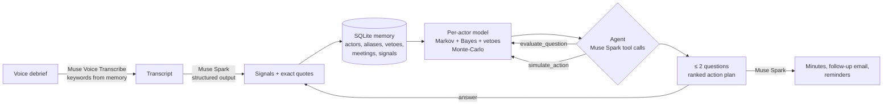

# deal-copilot

**A private, voice-first copilot for sales reps negotiating multi-year infrastructure contracts** (submarine cables, offshore wind, data centers). Built with Meta's Muse models during the Meta Global AI Developer Hackathon (October 27 – November 4, 2026).

> 60 seconds of dictation after a meeting. The agent spots what you missed, asks you at most 2 questions, and gives you the minutes, a ranked action plan and the follow-up email.

All companies, people, projects and figures in this repository are **fictional**.

---

## The problem

Selling a submarine cable or an offshore wind export system takes years and involves dozens of stakeholders: the operator, consortium partners, lenders, regulators, subcontractors. From experience in the telecom industry, working next to sales teams:

- what matters stays **in the rep's head**: meeting notes are rarely written, the CRM holds stages and amounts, not who said what;
- nobody sees clearly **who supports and who blocks**, and in these deals a single **veto holder** (the client's CFO, the lead lender, the regulator) can kill a contract that everyone else likes;
- forecasts rely on **gut feeling**, and the history is lost when someone changes jobs.

## The user

The **sales rep** themself. It is their tool to win their deal, **not a monitoring tool for their manager**. Friction is the enemy: one dictated debrief (in the car, on the train, under the shower), at most two one-sentence questions, each with a "Skip" button.

## What it does

1. **Dictate** a ~60 s debrief after a meeting. Muse Voice Transcribe transcribes it, with the names and aliases of the deal's stakeholders passed as `keywords` (pulled automatically from the deal memory).
2. **Extract** structured signals with Muse Spark: actor, stance (support / conditional / neutral / oppose), strength, source (said directly, reported, impression), confidence and the **exact quote**, which is verified word for word against the transcript.
3. **Update a per-actor stochastic model**: each stakeholder's hidden position, the veto rule, and the probability of signature with its 80 % interval.
4. **Active debrief**: the agent asks at most 2 questions, chosen by **value of information** (the expected reduction of uncertainty on the signature probability), usually about the most uncertain veto holder.
5. **Strategist**: a ranked action plan, each action priced by the model ("if the CFO became supportive: 38 % → 70 %"), plus the meeting minutes, the follow-up email and re-contact messages for silent stakeholders.
6. **Safety nets**: a major position change (support ↔ oppose, or a veto turning against us) must be **confirmed, corrected or rejected** by the rep. Every claim cites its source quote. The LLM never writes a number.

## Architecture: the LLM proposes, the model decides



| Module | Role |
|---|---|
| [`copilot/llm.py`](copilot/llm.py) | Single LLM client (Meta API or an open-weights provider), response cache, offline replay mode |
| [`copilot/capture.py`](copilot/capture.py) | Audio conversion to 16 kHz mono WAV, Muse Voice Transcribe, blind SNR estimate, optional denoising |
| [`copilot/extract.py`](copilot/extract.py) | Signal extraction (JSON schema), quote verification, reading of the rep's answers |
| [`copilot/memory.py`](copilot/memory.py) | SQLite: deals, organizations, actors with aliases and vetoes, meetings, signals, confirmations |
| [`copilot/model.py`](copilot/model.py) | Per-actor hidden positions, veto rule, Monte-Carlo, `posterior`, `simulate`, `explain` |
| [`copilot/decision.py`](copilot/decision.py) | Value of information for questions, expected effect of actions |
| [`copilot/agent.py`](copilot/agent.py) | Muse Spark tool-calling loop (max 8 rounds); its plan is checked and re-scored by the model |
| [`copilot/pipeline.py`](copilot/pipeline.py) | The end-to-end chain, change confirmations, emails and reminders |
| [`app.py`](app.py) | Streamlit interface (in French, for French-speaking reps) |
| [`eval/`](eval/) | Test-set generation, baselines and all experiments below |

### How each Meta model is used

| Model | Where | What for |
|---|---|---|
| **Muse Voice Transcribe** (`muse-voice-transcribe-1.0`) | `capture.py` | Debrief transcription. The deal's proper names are sent as `keywords`; the API limits each keyword to 30 characters, so long names are split. |
| **Muse Spark** (`muse-spark-1.3`), structured output | `extract.py` | Signals with stance, strength, source, confidence and verbatim quote (`reasoning_effort: low`). |
| **Muse Spark**, tool calling | `agent.py` | The agent reads signals (`get_signals`), prices questions (`evaluate_question`) and creative actions (`simulate_action`, e.g. "a payment schedule backed by a bank guarantee"), then submits a plan (`submit_plan`). The model re-checks it: unknown actors, invented numbers and actions with no effect are rejected. |
| **Muse Spark**, generation | `pipeline.py` | Minutes, follow-up email for action #1, re-contact messages. Rules: only facts from the file, no number, no internal analysis revealed. |
| **Muse Spark**, as an independent author | `eval/generate.py` | Writes the fictional test deals and the rep's imperfect debriefs **without knowing the model**. |
| **Muse Spark alone** | `eval/baselines.py` | The baseline we compare against: it reads the same debriefs and gives a probability or picks the questions itself. |

Open weights: `llm.py` can switch to Muse Spark Open (`meta-models/muse-spark-open-1026` on Baseten) through an environment variable. **This path has not been tested yet.**

## The stochastic model

**Why per actor and not a global "deal state" HMM?** A global state ("healthy", "at risk") has too many parameters for too little data, and it is not observable. Large contracts are decided by people, and some of them hold a veto.

- **Hidden position per actor** in {support, neutral, oppose}, starting from a prior (regulators get their own prior: they rarely oppose outright).
- **Each signal is a noisy observation.** Bayes update with a likelihood matrix tempered by confidence × strength × source: an exponent between 0 and 1, so a weak or reported signal moves the belief less.
  - A "conditional" stance ("we'll talk about it after the budget") is treated as **ambiguous**, almost as compatible with "oppose" as with "neutral": it is often the polite way of saying no.
- **Silence has a cost.** Between signals the belief drifts back to the prior (6 % per week), so uncertainty about an actor nobody has talked to grows over time.
- **Signature rule.** Every veto holder must let it pass (support 1.0, neutral 0.8, oppose 0.1). The other actors weigh by influence through a sigmoid of their weighted support:

  P(signature) = Π<sub>vetoes</sub> pass(position) × σ(3 · Σ w<sub>i</sub> v<sub>i</sub> / Σ w<sub>i</sub>), with v = +1 / 0 / −1.

- **Monte-Carlo** (4,000 draws, fixed seed) gives the mean and the 80 % interval.
- **Assumption, stated plainly:** actors are independent of each other. In reality, a lender often follows the CFO.

All parameters are in [`config/model_params.yaml`](config/model_params.yaml). They are set by hand, documented and readable by a sales rep. **None is fitted on the test sets.**

## Results

All experiments are reproducible from [`eval/`](eval/). The test deals are fictional, written by Muse Spark from character sheets with **hidden truth** (each actor's real position at each meeting) and an outcome (signed, lost, delayed). The rep's answers to the agent's questions are simulated from that hidden truth.

We used **two separate sets**:
- a **development set** of 10 deals, used to try changes;
- a **validation set** of 10 other deals with different plots, generated afterwards to judge the changes on deals never seen.

A first version of the generator leaked the outcome in the last debrief ("we finally signed"). This was detected, the generator was fixed and the set regenerated, **without touching the model**.

### 1. Outcome forecasting: Muse Spark alone wins

Brier score (lower is better; always answering 50 % gives 0.25). 40 forecasts per set, one per meeting.

| Method | Dev: all | Dev: last meeting | Validation: all | Validation: last meeting |
|---|---|---|---|---|
| **Muse Spark alone** | **0.178** | **0.037** | **0.178** | **0.034** |
| Model alone | 0.240 | 0.117 | 0.243 | 0.115 |
| Hybrid (model + 2 value-of-information questions) | 0.231 | 0.054 | 0.255 | 0.055 |

**The hybrid does not beat Muse Spark alone at predicting the outcome.**
- At the last meeting, the model ranks deals perfectly (AUC 1.00 on the dev set), but it stays too close to 50 %. Signed deals reach only 33–60 %, where Muse Spark gives 70–80 %.
- At the first meetings, it trusts early signals too much, while the generated stories often turn around later.

We tried, on the development set only:
- an asymmetric likelihood (a refusal weighs more than support);
- Platt recalibration;
- projecting positions to the decision date;
- a softer veto rule;
- averaging Muse Spark with the model.

None held up: either it was worse on the validation set, or it overfitted, or it only "won" by flattening every probability, which made the questions worthless. The model therefore stays at version 1. The rejected variant is kept in [`config/model_params_asym.yaml`](config/model_params_asym.yaml).

### 2. Consistency: where the model earns its place

A probability that a rep checks every week must be **stable and coherent**. We ran the same tests on Muse Spark alone and on the model, at meetings 2 and 4 of each deal (20 test points per set). See [`eval/consistency.md`](eval/consistency.md) and [`eval/consistency_holdout.md`](eval/consistency_holdout.md).

| Test | Muse Spark alone (dev / validation) | Model |
|---|---|---|
| Same input, 5 draws: average spread | 6 / 7 pts | 0 |
| Same input, 5 draws: worst spread | 12 / 20 pts | 0 |
| A veto holder says "I am against" < today < they say "I support it" | right order in **45 % / 35 %** of cases | 100 % |
| Effect of a veto holder saying "I support it" | −1 / 0 pts | +5 / +7 pts |
| "What if?" asked in two wordings: average gap | 7 / 5 pts | 0 (structured input) |
| "What if?" asked in two wordings: worst gap | 22 / 18 pts | 0 (structured input) |

The same fact can also be given to Muse Spark in two ways: as a hypothesis ("suppose the CFO supports the project") or as something reported in the debrief ("she told me she would approve it"). Its two answers differ by **14 pts on average and up to 52 pts**.

One honest note. Part of the model's advantage comes from being deterministic by construction. Muse Spark's asymmetry is not absurd either: verbal support is cheap and a clear refusal is decisive. The model, for its part, under-reacts to a clear refusal from a veto holder (−8 to −10 pts).

### 3. Extraction and questions

| | Dev | Validation |
|---|---|---|
| Signal extraction, exact stance: precision / recall | 88 % / 83 % | 80 % / 74 % |
| Signal extraction, "conditional" counted as neutral: precision / recall | 92 % / 86 % | 89 % / 83 % |
| Actors found | 94 % | 94 % |
| Correct actor positions: no question → value-of-information questions | 72 % → 79 % | 75 % → 80 % |
| Uncertainty (std) after 2 questions: value of information / Muse Spark's picks / random | 0.172 / 0.179 / 0.205 | 0.190 / 0.192 / 0.221 |
| Share of questions aimed at veto holders: value of information / Muse Spark's picks / random | 98 % / 94 % / 45 % | 100 % / 98 % / 51 % |
| Unsigned deals flagged (probability < 30 %): Muse Spark alone / model alone / hybrid | 6/6 · 4/6 · 6/6 | 6/6 · 6/6 · 6/6 |

The value-of-information questions clearly beat random ones. They beat Muse Spark's own picks only by a small margin, and on the validation set, random questions give as many correct positions (80 %).

### 4. Dictating in noisy places

Reps dictate where they can: on the train, in the car, under the shower. We mixed the trap debrief (52 s, synthetic voice) with synthetic transport, shower and babble noise at 10, 5 and 0 dB SNR. See [`eval/noise.md`](eval/noise.md).

- **Muse Voice Transcribe is robust.**
  - Word error rate is 6 % on clean audio and at most 14 % with noise as loud as the voice.
  - The deal's proper names are recognized exactly as on clean audio.
- **Our denoiser does not reliably help.** It is a spectral subtraction whose noise estimate corrects the bias of the 10th percentile of an exponential law, and it improves the SNR by up to 11 dB. But the word error rate varies as much from one run to the next as the filter's effect, and strong subtraction even hurts recognition.
- It is therefore **off by default**. The blind SNR estimate (accurate to about 1 dB) is only used to warn the rep when the recording is very noisy.

### What this means

On these stories, Muse Spark alone is the better forecaster of the outcome, and we say so. The per-actor model brings what a rep needs to **act**:
- a number that does not move without new information;
- an explicit view of vetoes and silent stakeholders, with a quote behind every move;
- questions aimed at the veto holders;
- "what if?" numbers that do not depend on the wording.

### Limits

- Small sets: 2 × 10 deals and 2 × 40 forecasts.
- The stories are written by the same model that serves as the baseline, which may favor it.
- The rep's answers are simulated.
- The noise test uses one synthetic-voice recording.
- No test with real reps yet.
- The test stories are built around turnarounds, which penalizes a model that trusts early signals.

## Run it

Windows / PowerShell, Python 3.12:

```powershell
python -m venv .venv
.\.venv\Scripts\pip install -r requirements.txt
copy .env.example .env      # then put your Meta Model API key in .env (never commit it)
.\.venv\Scripts\python.exe -m streamlit run app.py
```

Without a key, the app runs in **offline mode** and replays cached Muse responses.

```powershell
.\.venv\Scripts\python.exe -m pytest tests -q              # 31 tests, no network
.\.venv\Scripts\python.exe -m eval.evaluate                # forecasting, extraction, questions (dev set)
.\.venv\Scripts\python.exe -m eval.evaluate holdout        # same on the validation set
.\.venv\Scripts\python.exe -m eval.consistency holdout     # stability and coherence
.\.venv\Scripts\python.exe -m eval.noise                   # noisy dictation (needs outputs/debrief_piege.wav)
```

## Data, sources and licenses

- **No external dataset is used.**
  - The demo deal ([`data/demo_deal/`](data/demo_deal/)) and both test sets ([`data/scenarios/`](data/scenarios/), [`data/scenarios_holdout/`](data/scenarios_holdout/)) are fictional.
  - They feature companies and private lenders only: no real company, person or place, and no countries.
  - The test sets were generated with Muse Spark for this project.
- **No real or confidential data** has been sent to the APIs.
- **Code:** GNU AGPL-3.0, see [`LICENSE`](LICENSE). Everything in this repository was written during the hackathon.
- **Dependencies:**
  - openai, Streamlit, requests: Apache-2.0
  - Plotly, PyYAML, pytest: MIT
  - NumPy, pandas, python-dotenv: BSD
- **Font:** Inter, from Google Fonts, SIL Open Font License.
- **API documentation:** the official Meta Model cookbook, [github.com/meta-models/meta-model-cookbook](https://github.com/meta-models/meta-model-cookbook).
