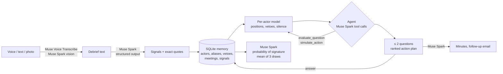

# deal-copilot

**A private, voice-first copilot for sales reps negotiating multi-year infrastructure contracts** (submarine cables, offshore wind, data centers). Built with Meta's Muse models during the Meta Global AI Developer Hackathon (October 27 – November 4, 2026).

> 60 seconds of dictation after a meeting. The copilot spots what you missed, asks you at most 2 questions, and gives you the minutes, a ranked action plan and the follow-up email.

All companies, people, projects and figures in this repository are **fictional**.

---

## The problem

Selling a submarine cable or an offshore wind export system takes years and involves dozens of stakeholders: the operator, consortium partners, lenders, regulators, subcontractors. From experience in the telecom industry, working next to sales teams:

- what matters stays **in the rep's head**: meeting notes are rarely written, the CRM holds stages and amounts, not who said what;
- nobody sees clearly **who supports and who blocks**, and in these deals a single **veto holder** (the client's CFO, the lead lender, the regulator) can kill a contract that everyone else likes;
- forecasts rely on **gut feeling**, and the history is lost when someone changes jobs.

## The user

The **sales rep** themself. It is their tool to win their deal, **not a monitoring tool for their manager**. Friction is the enemy: one debrief right after the meeting, dictated in the car or on the train, typed, or snapped from handwritten notes or a whiteboard. Then at most two one-sentence questions, each with a "Skip" button.

## What it does

1. **Debrief in 60 seconds**, whichever way is easiest:
   - **by voice**: Muse Voice Transcribe, with the deal's names and aliases passed as `keywords`, pulled automatically from the deal memory;
   - **as text**;
   - **as a photo** of handwritten notes or a whiteboard: Muse Spark's vision rewrites it as clean, structured notes that the rep reviews.
2. **Signals**: Muse Spark extracts who said what. Each signal has an actor, a stance (supportive / conditional / neutral / opposed), a strength, a source (said directly, reported, impression) and a confidence. Each also carries the **exact quote**, checked word for word against what the rep said.
3. **Probability of signature**: Muse Spark reads the whole file and estimates it. It is re-estimated after every debrief, answer or note, and it is the **average of 3 independent draws**.
4. **Who supports, who blocks**: a per-actor stochastic model remembers each stakeholder's position across months. It weighs silence and spots the **most uncertain veto holder**.
5. **The copilot's questions**: at most 2, proposed by Muse Spark and ranked by the model by **value of information**. In practice, they aim at the veto holder the rep has not really read.
6. **Action plan**: Muse Spark proposes actions, including creative ones ("a payment schedule backed by a bank guarantee"). The model checks and ranks them, then Muse Spark drafts the minutes and the follow-up email.
7. **Safety nets**:
   - a major position change (supportive ↔ opposed, or a veto holder turning against us) must be **confirmed, corrected or rejected** by the rep;
   - an unknown name must be linked to someone before it counts;
   - every claim cites its quote.

## Design: each component does what it measurably does best

We started with a stochastic model for everything, then measured it against Muse Spark alone on fictional deals (see [Results](#results)). The design follows the measurements:

| Need | Who does it | Why (measured) |
|---|---|---|
| The probability of signature | **Muse Spark**, average of 3 draws | It forecasts the outcome better than our model: Brier 0.178 against 0.24 on two separate test sets. Averaging 3 draws halves its run-to-run noise without losing accuracy. |
| Remembering each stakeholder, vetoes, silences | **Per-actor model** (Markov + Bayes) | It is stable and coherent. Muse Spark alone moves by up to 20 points with no new information, and orders "veto says no" < "today" < "veto says yes" correctly in only 35–45 % of cases. |
| Choosing the 2 questions | **Muse Spark proposes, the model ranks** | The questions reach the veto holders 98–100 % of the time and reduce uncertainty by 18–24 % (random questions: 45–51 % and 4–9 %). They do not make Muse Spark's forecast more accurate on our test set (see Results). |
| Ranking actions | **Muse Spark proposes, the model ranks** | The model's "what if?" does not depend on the wording; Muse Spark's moves by up to 22 points between two phrasings of the same hypothesis. Impact is shown as high / medium / low, so the model's scale never contradicts the displayed probability. |
| Reading speech, photos, writing emails | **Muse Voice Transcribe, Muse Spark** | That is what they are for. Nothing is invented: every quote is checked, and generated texts contain no figures. |



| Module | Role |
|---|---|
| [`copilot/llm.py`](copilot/llm.py) | Single LLM client (Meta API or an open-weights provider), response cache, offline replay |
| [`copilot/capture.py`](copilot/capture.py) | Audio conversion to 16 kHz mono WAV, Muse Voice Transcribe, blind SNR estimate |
| [`copilot/photo.py`](copilot/photo.py) | Photo of notes or a whiteboard → clean structured notes and the people visible (Muse Spark vision) |
| [`copilot/extract.py`](copilot/extract.py) | Signal extraction (JSON schema), quote verification, reading of the rep's answers |
| [`copilot/memory.py`](copilot/memory.py) | SQLite: deals, organizations, actors with aliases and vetoes, meetings, signals, confirmations |
| [`copilot/forecast.py`](copilot/forecast.py) | Probability of signature by Muse Spark, average of 3 parallel draws |
| [`copilot/model.py`](copilot/model.py) | Per-actor hidden positions, veto rule, Monte-Carlo, `posterior`, `simulate` |
| [`copilot/decision.py`](copilot/decision.py) | Value of information for questions, expected effect of actions |
| [`copilot/agent.py`](copilot/agent.py) | Muse Spark tool-calling loop (max 8 rounds); its plan is checked and re-scored by the model |
| [`copilot/pipeline.py`](copilot/pipeline.py) | The end-to-end chain, change confirmations, follow-up email |
| [`app.py`](app.py) | Streamlit interface: one screen, in the order of the workflow |
| [`eval/`](eval/) | Test-set generation, baselines and all the experiments below |

### How each Meta model is used

| Model | Where | What for |
|---|---|---|
| **Muse Voice Transcribe** (`muse-voice-transcribe-1.0`) | `capture.py` | Debrief transcription. The deal's proper names are sent as `keywords`; the API limits each keyword to 30 characters, so long names are split. |
| **Muse Spark** (`muse-spark-1.3`), structured output | `extract.py`, `forecast.py` | Signals with stance, strength, source, confidence and verbatim quote; the probability of signature with its rationale (`reasoning_effort: low`). |
| **Muse Spark**, tool calling | `agent.py` | The agent reads signals (`get_signals`), evaluates questions (`evaluate_question`) and creative actions (`simulate_action`), then submits a plan (`submit_plan`). The model re-checks it: unknown actors, invented numbers and actions with no effect are rejected. |
| **Muse Spark**, vision | `photo.py` | A photo of handwritten notes or a whiteboard becomes structured data: kind of document, cleaned-up notes in sections, date, unreadable passages, people with title and organization. The deal's known names help it read handwriting: "Sophie L." on the sample whiteboard is matched to Sophie Lenoir, and a new person spotted on the notes is offered to the rep. |
| **Muse Spark**, generation | `pipeline.py` | Minutes and the follow-up email for action #1. Rules: only facts from the file, no figures. |
| **Muse Spark**, as an independent author | `eval/generate.py` | Writes the fictional test deals and the rep's imperfect debriefs **without knowing our model**. |

Open weights: `llm.py` can switch to Muse Spark Open (`meta-models/muse-spark-open-1026` on Baseten) through an environment variable. **This path has not been tested yet.**

## The stakeholder model

**Why per actor and not a global "deal state" HMM?** A global state ("healthy", "at risk") has too many parameters for too little data, and it is not observable. Large contracts are decided by people, and some of them hold a veto.

- **Hidden position per actor** in {supportive, neutral, opposed}, starting from a prior (regulators get their own prior: they rarely oppose outright).
- **Each signal is a noisy observation.** Bayes update with a likelihood matrix tempered by confidence × strength × source: an exponent between 0 and 1, so a weak or reported signal moves the belief less.
  - A "conditional" stance ("we'll talk about it after the budget") is treated as **ambiguous**, almost as compatible with "opposed" as with "neutral": it is often the polite way of saying no.
- **Silence has a cost.** Between signals the belief drifts back to the prior (6 % per week), so uncertainty about an actor nobody has talked to grows over time.
- **Signature rule**, used to rank questions and actions. Every veto holder must let it pass (supportive 1.0, neutral 0.8, opposed 0.1). The other actors weigh by influence through a sigmoid of their weighted support, and Monte-Carlo (4,000 draws, fixed seed) gives the distribution:

  P(signature) = Π<sub>vetoes</sub> pass(position) × σ(3 · Σ w<sub>i</sub> v<sub>i</sub> / Σ w<sub>i</sub>), with v = +1 / 0 / −1.

- **Value of information** of a question: the expected reduction of the spread of that distribution, averaged over the possible answers weighted by their probability.
- **Assumption, stated plainly:** actors are independent of each other. In reality, a lender often follows the CFO.

All parameters are in [`config/model_params.yaml`](config/model_params.yaml). They are set by hand, documented and readable by a sales rep. **None is fitted on the test sets.**

## Results

All experiments are reproducible from [`eval/`](eval/). The test deals are fictional. Muse Spark wrote them from character sheets with a **hidden truth** (each actor's real position at each meeting) and an outcome (signed, lost, delayed). The rep's answers to the copilot's questions are simulated from that hidden truth.

We used **two separate sets**:
- a **development set** of 10 deals, used to try changes;
- a **validation set** of 10 other deals with different plots, generated afterwards to judge the changes on deals never seen.

A first version of the generator leaked the outcome in the last debrief ("we finally signed"). This was detected, the generator was fixed and the set regenerated, **without touching the model**.

### 1. Forecasting the outcome: Muse Spark wins, so it gives the probability

Brier score (lower is better; always answering 50 % gives 0.25). 40 forecasts per set, one per meeting.

| Method | Dev: all | Dev: last meeting | Validation: all | Validation: last meeting |
|---|---|---|---|---|
| **Muse Spark** | **0.178** | **0.037** | **0.178** | **0.034** |
| Per-actor model alone | 0.240 | 0.117 | 0.243 | 0.115 |
| Model + 2 questions | 0.231 | 0.054 | 0.255 | 0.055 |

The model ranks deals perfectly at the last meeting (AUC 1.00 on the dev set), but it stays too close to 50 %. On the development set only, we tried several fixes:
- an asymmetric likelihood;
- Platt recalibration;
- projecting positions to the decision date;
- a softer veto rule;
- averaging Muse Spark with the model.

None held up on the validation set: each one either overfitted or simply flattened every probability. The rejected variant is kept in [`config/model_params_asym.yaml`](config/model_params_asym.yaml). **So the probability shown to the rep comes from Muse Spark**, with exactly the prompt used in this evaluation ([`copilot/forecast.py`](copilot/forecast.py)).

**Averaging draws removes Muse Spark's instability.** We measured it on 40 points (meetings 2 and 4 of all 20 deals, 5 draws each):

| | Brier | Run-to-run noise (std) |
|---|---|---|
| 1 draw | 0.150 | 2.7 pts |
| **Average of 3 draws** (used) | **0.154** | **≈ 1.5 pts** |
| Average of 5 draws | 0.153 | ≈ 1.2 pts |
| Per-actor model | 0.227 | 0 |

### 2. Consistency: why the model keeps the memory and the ranking

We ran the same tests on Muse Spark alone and on the model, at meetings 2 and 4 of each deal (20 test points per set). See [`eval/consistency.md`](eval/consistency.md) and [`eval/consistency_holdout.md`](eval/consistency_holdout.md).

| Test | Muse Spark alone (dev / validation) | Model |
|---|---|---|
| Same input, 5 draws: worst spread | 12 / 20 pts | 0 |
| A veto holder says "I am against" < today < they say "I support it" | right order in **45 % / 35 %** of cases | 100 % |
| "What if?" asked in two wordings: average gap | 7 / 5 pts | 0 (structured input) |
| "What if?" asked in two wordings: worst gap | 22 / 18 pts | 0 (structured input) |

The same fact can also be given to Muse Spark in two ways: as a hypothesis ("suppose the CFO supports the project") or as something reported in the debrief ("she told me she would approve it"). Its two answers differ by **14 pts on average and up to 52 pts**.

That is why the stable model ranks questions and actions. One honest note: part of the model's advantage comes from being deterministic by construction, and the model under-reacts to a clear refusal from a veto holder (−8 to −10 pts).

### 3. Extraction and questions

| | Dev | Validation |
|---|---|---|
| Signal extraction, exact stance: precision / recall | 88 % / 83 % | 80 % / 74 % |
| Signal extraction, "conditional" counted as neutral: precision / recall | 92 % / 86 % | 89 % / 83 % |
| Actors found | 94 % | 94 % |
| Correct actor positions: no question → 2 ranked questions | 72 % → 79 % | 75 % → 80 % |
| Uncertainty after 2 questions: ranked / Muse Spark's own picks / random | −24 % / −20 % / −9 % | −18 % / −17 % / −4 % |
| Share of questions aimed at veto holders: ranked / Muse Spark's own picks / random | 98 % / 94 % / 45 % | 100 % / 98 % / 51 % |

The ranked questions clearly beat random ones. They beat Muse Spark's own picks only by a small margin, and on the validation set, random questions give as many correct positions (80 %).

**Do the answers improve the displayed forecast? No, not on this test set.** In the product, the rep's answers are added to the deal file and Muse Spark re-reads everything. We replayed exactly that on all 80 forecasts, with the answers simulated from the hidden truth. See [`eval/questions_forecast.md`](eval/questions_forecast.md).

| Brier score of Muse Spark's forecast | Dev | Validation | Both (90 % interval of the gain) |
|---|---|---|---|
| No question | 0.178 | 0.178 | 0.178 |
| + answers to the copilot's 2 questions | 0.172 | 0.189 | 0.180 ([−0.014 ; +0.010]) |
| + answers on Muse Spark's own picks | 0.174 | 0.187 | 0.181 ([−0.011 ; +0.006]) |
| + answers on 2 random actors | 0.173 | 0.182 | 0.178 ([−0.008 ; +0.009]) |

The answers move the forecast by 4 to 5 points on average, barely more than the spread between two draws. Two reasons:
- **early in a deal, today's positions do not predict the outcome**, because these stories turn on later reversals (the Brier score is about 0.27 at meetings 1–2 with or without answers);
- **at the last meeting, the debriefs already say almost everything** (Brier 0.036).

So we do not claim that the questions make the forecast more accurate. What they demonstrably do is fill the deal file where it is blind: they target the veto holders, correct the actors' positions (72 % → 79 %) and cut the model's uncertainty by about a fifth. In the trap demo, that one answer is what surfaces the hidden risk.

### 4. Dictating in noisy places

Reps dictate where they can: on the train, in the car. We mixed the trap debrief (52 s, synthetic voice, French version) with synthetic transport, shower and babble noise at 10, 5 and 0 dB SNR. See [`eval/noise.md`](eval/noise.md).

- **Muse Voice Transcribe is robust**: the word error rate is 6 % on clean audio and at most 14 % with noise as loud as the voice, and the deal's proper names are recognized as on clean audio.
- **A spectral-subtraction denoiser does not reliably help.** It improves the SNR by up to 11 dB, but the transcription varies as much from one run to the next as the filter's effect.
- So the audio is sent as is, and a blind SNR estimate (accurate to about 1 dB) only warns the rep when the recording is very noisy.

### 5. Lessons from past deals

When a deal closes, Muse Spark writes the end-of-deal review from the whole file: turning points, what went well and badly, and 2 to 4 lessons in general terms (by role and situation, no names). Every turning point and lesson must carry a quote found word for word in the debriefs ([`copilot/retro.py`](copilot/retro.py)). **Do these lessons help forecast a new deal?** Cross-validation: each set's deals are forecast with the 30 lessons from the other set. See [`eval/lessons_forecast.md`](eval/lessons_forecast.md).

| Muse Spark's forecast (mean of 3 draws, 80 forecasts) | Brier | AUC |
|---|---|---|
| Without lessons | 0.182 | 0.83 |
| Without lessons + best constant shift, chosen knowing the outcomes | 0.171 | 0.83 |
| **With lessons from the other set** | **0.163** | **0.86** |

The gain is +0.020 (90 % interval [+0.007 ; +0.033]): +0.024 when forecasting the dev set, +0.015 on the validation set. It beats even the best shift chosen after the fact, so the lessons carry information, not just a level. Signed deals are recognized earlier. Caveat: the stories and the lessons come from the same model, which may flatter the result.

### Limits

- Small sets: 2 × 10 deals and 2 × 40 forecasts.
- The stories are written by the same model that gives the probability, which may favor it.
- The rep's answers are simulated.
- The noise test uses one synthetic-voice recording.
- No test with real reps yet.

## Run it

Windows / PowerShell, Python 3.12:

```powershell
python -m venv .venv
.\.venv\Scripts\pip install -r requirements.txt
copy .env.example .env      # then put your Meta Model API key in .env (never commit it)
.\.venv\Scripts\python.exe -m streamlit run app.py
```

Every analysis calls Muse live. The Muse responses for the sample deal and the two sample photos are also published in [`data/demo_cache/`](data/demo_cache/), as a **safety net**: if the API does not answer, the app still works on these inputs instead of failing.

### Online version

The hosted version is the same app, calling Muse live, on Streamlit Community Cloud. Its settings are listed in [`.streamlit/secrets.toml.example`](.streamlit/secrets.toml.example), and the real key is set only in the host's secrets, never in the repository.

- **One private, in-memory database per visitor** (`DEAL_COPILOT_DB=session`): visitors never see each other's changes.
- **A limit of actions that call Muse per visit** (`DEAL_COPILOT_MAX_ACTIONS`), because the credits are shared.

```powershell
.\.venv\Scripts\python.exe -m pytest tests -q              # tests, no network
.\.venv\Scripts\python.exe -m eval.evaluate                # forecasting, extraction, questions (dev set)
.\.venv\Scripts\python.exe -m eval.evaluate holdout        # same on the validation set
.\.venv\Scripts\python.exe -m eval.consistency holdout     # stability and coherence
.\.venv\Scripts\python.exe -m eval.questions_forecast      # do answers improve Muse Spark's forecast?
.\.venv\Scripts\python.exe -m eval.lessons_forecast        # do lessons from past deals help?
.\.venv\Scripts\python.exe -m eval.demo_cache              # rebuild the safety-net cache
```

## Data, sources and licenses

- **No external dataset is used.**
  - The sample deal ([`data/demo_deal/`](data/demo_deal/)) and both test sets ([`data/scenarios/`](data/scenarios/), [`data/scenarios_holdout/`](data/scenarios_holdout/)) are fictional.
  - They feature companies and private lenders only: no real company, person or place, and no countries.
  - The test sets were generated with Muse Spark for this project, in French (the evaluation was run before the app moved to English).
- The sample photos are generated by [`samples/make_samples.py`](samples/make_samples.py), with fonts that ship with Windows. Only the rendered images are published, not the fonts.
- **No real or confidential data** has been sent to the APIs.
- **Code:** GNU AGPL-3.0, see [`LICENSE`](LICENSE). Everything in this repository was written during the hackathon.
- **Dependencies:**
  - openai, Streamlit, requests: Apache-2.0
  - Plotly, PyYAML, pytest: MIT
  - NumPy, pandas, python-dotenv: BSD
  - Pillow: MIT-CMU
- **Font:** Inter, from Google Fonts, SIL Open Font License.
- **API documentation:** the official Meta Model cookbook, [github.com/meta-models/meta-model-cookbook](https://github.com/meta-models/meta-model-cookbook).
